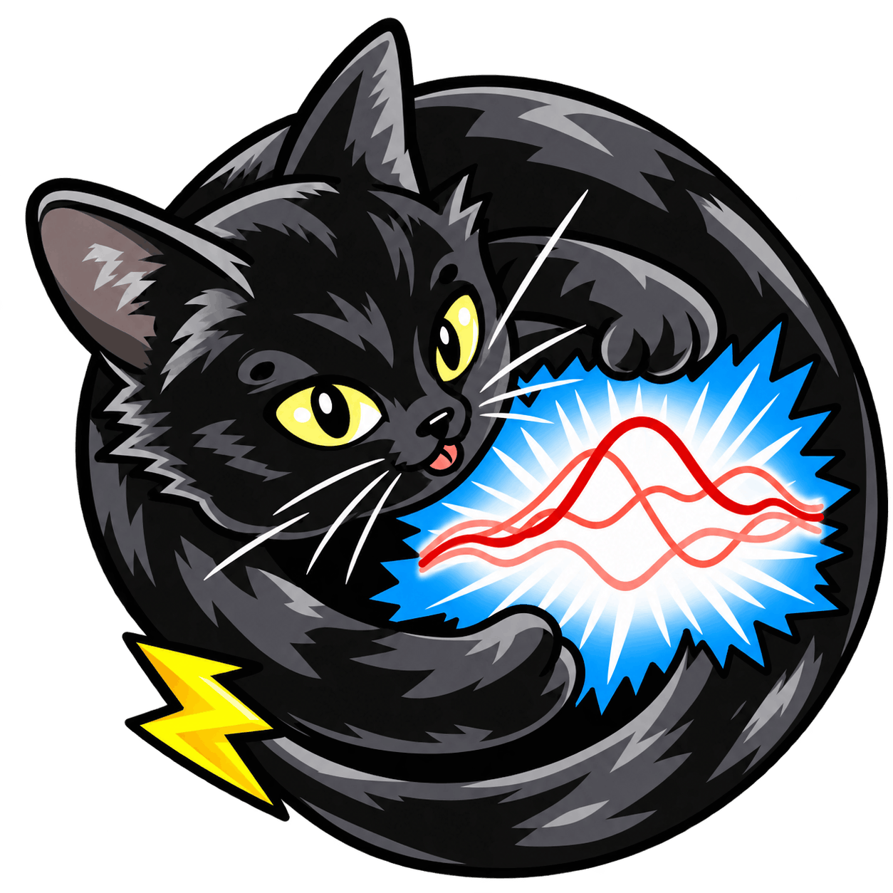

# GENCO Foresight



<p>• <b>MODEL</b>: Extends pre-trained GENCO from AC-OPF solver to a probabilistic forecaster</p>
<br>
<p>• <b>DATA</b>: Temporal dimension from EIA ERCOT 2025, operating-stress calibration for voltage and line events</p>
<br>
<p>• <b>TRAINING</b>: Synthetic temporal dataset: 10,080 Ipopt-labeled hours driven by EIA ERCOT 2025 demand</p>
<br>
<p>• <b>OPTIMIZER</b> Anticipatory solver warm starts evaluated against cold starts (no solver benefit observed at 2.93× cost)</p>
<br>
<p>• <b>SYSTEM</b> Reproducible on Aurora (XPU) HPC and NVIDIA (CUDA) systems, with CPU fallback</p>

<br clear="all">

## Motivation 

## Method

## Empirical Highlights

## Conclusion

## References
Below, the key references.

[GridFM graphkit](https://gridfm.github.io/gridfm-graphkit/) - A library to train, finetune and interact with a foundation model for the electric power grid. (Puech, et al., 2025). 
```bash
@article{puech2025gridfmdatakitv1pythonlibraryscalable,
  title={gridfm-datakit-v1: A Python Library for Scalable and Realistic Power Flow and Optimal Power Flow Data Generation},
  author={Alban Puech and Matteo Mazzonelli and Celia Cintas and Tamara R. Govindasamy and Mangaliso Mngomezulu and Jonas Weiss and Matteo Baù and Anna Varbella and François Mirallès and Kibaek Kim and Le Xie and Hendrik F. Hamann and Etienne Vos and Thomas Brunschwiler},
  journal={arXiv preprint arXiv:2512.14658},
  year={2025},
  url={https://arxiv.org/abs/2512.14658}
}
```

[GENCO](https://arxiv.org/abs/2608.09921) - A Unified Neural Solver Embedded in a Development Framework for Steady-State Grid Analysis; (<u>GE</u>ometric <u>N</u>eural <u>C</u>orrective <u>O</u>ptimizer) (Puech et. al, 2026)

```bash
@article{puech2026gencounifiedneural,
  title={GENCO - A Unified Neural Solver Embedded in a Development Framework for Steady-State Grid Analysis},
  author={Alban Puech and Matteo Mazzonelli and Tamara R. Govindasamy and Mangaliso Mngomezulu and Héctor Maeso-García and Thomas Tolhurst and Javad Bayazi and Ali Moeini and Naomi Simumba and Celia Cintas and David Nelischer and Romeo Kienzler and Jonas Weiss and Anna Varbella and Florian Dörfler and Gabriela Hug and Martin Mevissen and Juan Bernabé-Moreno and François Mirallès and Hendrik F. Hamann and Etienne Vos and Thomas Brunschwiler},
  journal={arXiv preprint arXiv:2608.09921},
  year={2026},
  url={https://arxiv.org/abs/2608.09921}
}
```

[IPOPT](https://cepac.cheme.cmu.edu/pasilectures/biegler/ipopt.pdf) - On the implementation of an interior-point filter line-search
algorithm for large-scale nonlinear programming (Wächter, Biegler, 2005)

```bash
@article{wachter2006implementation,
  title={On the implementation of an interior-point filter line-search algorithm for large-scale nonlinear programming},
  author={W{\"a}chter, Andreas and Biegler, Lorenz T},
  journal={Mathematical programming},
  volume={106},
  number={1},
  pages={25--57},
  year={2006},
  publisher={Springer}
}
```

[PowerModels.jl](https://arxiv.org/abs/1711.01728) - An Open-Source Framework for Exploring Power Flow Formulations (Coffrin, et al., 2017)
```bash
@inproceedings{coffrin2018powermodels,
  title={Powermodels. jl: An open-source framework for exploring power flow formulations},
  author={Coffrin, Carleton and Bent, Russell and Sundar, Kaarthik and Ng, Yeesian and Lubin, Miles},
  booktitle={2018 Power Systems Computation Conference (PSCC)},
  pages={1--8},
  year={2018},
  organization={IEEE}
}
```

[ERCO: EIA's Hourly Electric Grid Monitor](https://www.eia.gov/electricity/gridmonitor/dashboard/electric_overview/balancing_authority/ERCO) from the Electric Reliability Council of Texas, Inc. (ERCO)

```bash
@misc{eia_erco,
  author = {{U.S. Energy Information Administration}},
  title  = {Hourly Electric Grid Monitor: Electric Reliability Council of Texas ({ERCO})},
  url    = {https://www.eia.gov/electricity/gridmonitor/dashboard/electric_overview/balancing_authority/ERCO},
  note   = {Accessed: 2026-10-24}
}
```

## V2 production policy

Determinism OFF is **adopted with disclosure** for new V2 production runs; use
`configs/v2/production.yaml`. Historical v3/v4 configurations and manifests retain
ON, as do evaluation and resume-mechanism checks. The case30 OFF selection-ES mean
is 0.290849888 versus 0.285553075 for historical ON seeds (Δ = +0.005296813).
Mean test ES is 0.307292007 versus 0.300798303 (Δ = +0.006493704); the three-seed
comparison does not establish statistical equivalence, and some voltage metrics
also differ. Two OFF seeds exceed the historical selected-ES range. This operational
adoption does not turn the earlier failed gates into passes. See the complete
[Stage 1 verdict](reports/v2/stage1_verdict.md), including seed identities, stopping
reasons, all test metrics and the separate confirmation-job exceedance.

## Multigrid CPU format support

The V2 A0 and λ ablations use separate run identities and a 3.3-hour worker cap.
Apply `configs/v2/a0.yaml`, `lambda01.yaml`, or `lambda10.yaml` as overrides through
`load_config`; they are not standalone complete configurations. A0 freezes latent
conditioning and runs GENCO under `no_grad`, then adds final-state innovations and
recomputes differentiable physics. Its demand head still receives direct demand-ES
gradients. The conditioned adapter remains the production model. The frozen GENCO
path and the default adapter forward were checked before these experiments.

This repository supports case14, case30, case57, case118, case500, and case2000.
Select a case with `GENCO_CONFIG=configs/multigrid/case118_ieee.yaml`; the selector
uses the v4 recipe and separate output paths. `GridSpec` supplies dimensions,
reference buses, generator mappings, and offline masks.

Run `python -m scripts.multigrid_smoke` for CPU loading and formatting checks, then
`python -m scripts.multigrid_report` to refresh [the support report](reports/multigrid/support.md).
These checks launch no solver, training, or PBS job. Bulk artifacts stay on `/lus/flare`;
the existing Torch/Transformers environment is retained.
